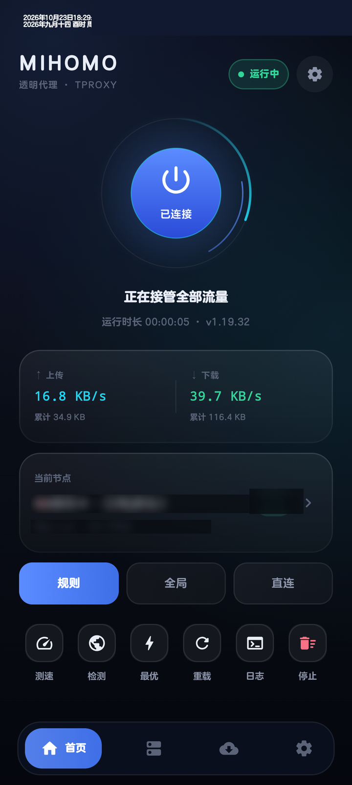
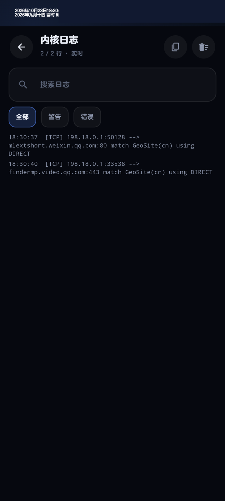
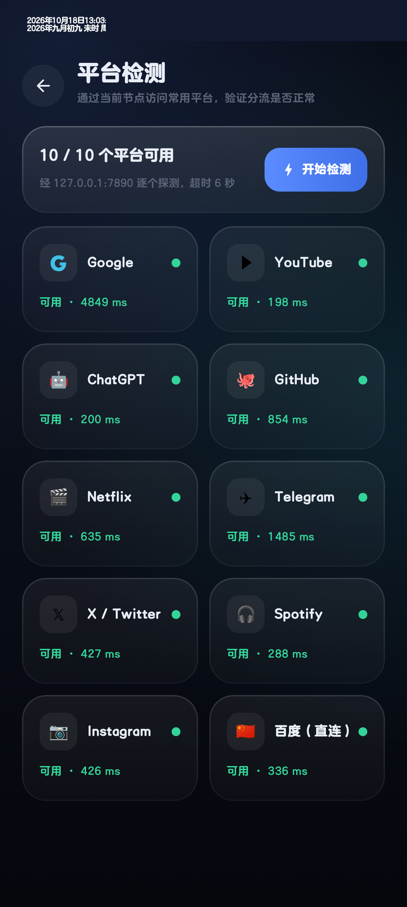
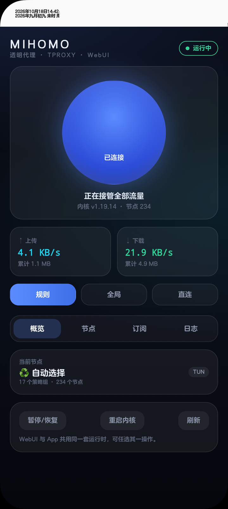

# Mihomo 透明代理 · Mihomo TProxy

[](https://github.com/De4869/mihomo-tproxy/actions/workflows/ci.yml)
[](https://github.com/De4869/mihomo-tproxy/releases)


给 **已 Root 的安卓手机**（KernelSU / Magisk / APatch / SukiSU）用的 mihomo 透明代理方案：
**App 图形界面 + mihomo 内核（构建时拉取最新 release）+ Root 级 TUN 全局接管**，不占用系统 VPN 入口，状态栏不会出现 VPN 图标，也不会被"检测 VPN"的 App 识别。

> 参考并改进了 GitHub 上的 [MagicNet](https://github.com/LIghtJUNction/MagicNet) 与 [NetProxy-Magisk](https://github.com/Fanju6/NetProxy-Magisk)：
> 它们的思路很好（Root 级 TUN、无 VPN 槽位），但都是 sing-box 内核 + 命令行/配置文件操作，配置繁琐、节点要自己拼、出问题只能看日志。
> 本项目换成 **mihomo（Clash.Meta）内核**，把全部操作收进一个原生 Compose App：订阅一键导入、节点整合去重、自动测速选优、热重载开关，不重启进程。

---

## 1. 特性

| 能力 | 说明 |
|---|---|
| **mihomo 内核** | arm64 内核随构建拉取最新 release（默认 v1.19.32），支持 vmess / vless / trojan / ss / hysteria2 / tuic 等全部主流协议，可在 App 内一键更新 |
| **无 VPN 槽位** | 直接用 `/dev/net/tun` + 策略路由接管全局流量，不创建 VpnService，不显示 VPN 图标 |
| **订阅导入** | 支持 Clash 订阅链接（自动识别 YAML / base64 分享链接）、多行粘贴节点链接、本地 YAML |
| **节点整合** | 多个订阅一键合并，按 `类型+服务器+端口+凭据` 去重，重名自动改名，自动按地区分组（港/台/日/新/美…） |
| **自动选优** | 调 mihomo 的 `/group/{name}/delay` 一次并发测完整个策略组，自动选中最低延迟；同时生成 ♻️自动选择 / 🔯故障转移 / ⚖️负载均衡 策略组 |
| **平台检测** | 一键检测 Google / YouTube / ChatGPT / GitHub / Netflix / Telegram / X / Spotify / Instagram / 百度，给出每个平台的可用性与延迟 |
| **在线广告规则** | 广告拦截除内置 `GEOSITE,category-ads-all` 外，可导入任意 mihomo rule-provider 地址（内置 ACL4SSR BanAD / 程序广告预设，走 gh-proxy 镜像），按 `RULE-SET,adN,REJECT` 生效，24h 自动更新 |
| **内核更新** | 「设置 → 检查更新」查询 GitHub 最新 release（走当前代理），发现新版本可一键下载 .gz、替换二进制并自动重启；重启 App 不会把内核降级回内置版本 |
| **不重启开关** | 大按钮暂停/恢复代理只改 mihomo 运行模式（`PATCH /configs`），内核不退出、连接不断 |
| **热重载** | 换订阅、改 DNS、改分流、改分应用名单 → 写配置后 `PUT /configs` 热加载，同样不重启进程 |
| **分流规则** | 内置智能分流（GEOSITE/GEOIP 国内直连）、全局代理、全局直连；广告拦截开关；可视化分应用黑白名单 |
| **实时状态** | 上下行速率、累计流量、运行时长、节点延迟、内核日志（实时流） |
| **开机自启** | 写入 `/data/adb/service.d`，开机 25 秒后自动拉起 |
| **模块化** | 附带 KernelSU/Magisk 模块 zip（可选），App 单独也能用；模块自带 WebUI（概览/节点/订阅/日志），不装 App 也能操作 |
| **快捷磁贴** | 下拉通知栏「Mihomo」磁贴一键启停代理，不用打开 App |
| **日志面板** | 级别筛选（全部/警告/错误）、关键字搜索、一键复制、错误标红、滚到底自动跟随 |

## 界面

<p align="center">
  
  
  
  
</p>

> 节点名称已打码，截图里不包含订阅地址。

## 2. 目录

```
透明代理/
├─ Android/       App 源码（Kotlin + Jetpack Compose）
├─ module/        KernelSU / Magisk 模块（含 WebUI：webroot/index.html）
├─ scripts/       fetch-deps.sh（拉内核 + geo）、set-repo.sh（更新通道）
├─ docs/          测试记录 + 演示截图
└─ .github/       CI、Release、Issue 模板、Dependabot
```

## 3. 安装

### 3.1 只装 App（推荐）

```bash
adb install -r dist/MihomoTProxy-1.0.0.apk
```

1. 打开 App，KernelSU 会弹出 Root 授权 → **允许**（勾选记住）。
2. 首次启动自动把内核、geo 数据库、控制脚本安装到 `/data/adb/mihomo_tproxy`（约 5 秒）。
3. 进入「订阅」→ 右上角 **+** → 粘贴订阅链接或节点链接 → 添加。
4. 回到首页 → 点大圆环开关 → 代理生效。

### 3.2 模块（可选）

```bash
adb push dist/MihomoTProxy-Module-v1.0.0.zip /data/local/tmp/
adb shell su -c "ksud module install /data/local/tmp/MihomoTProxy-Module-v1.0.0.zip"
```

模块只负责：装内核/geo/控制脚本 + 开机按 `/data/adb/mihomo_tproxy/auto_start` 标志启动内核。
App 仍然是控制面板；两者共用同一套运行时目录。

## 4. 使用要点

- **大圆环**：启动/暂停代理。暂停时内核仍在运行（状态 "已暂停"），网络立即恢复直连；再点恢复，秒切回。
- **首页模式条**：规则 / 全局 / 直连，点击即生效（`PATCH /configs`，不重启）。
- **节点页**：「全部测速」并发测所有节点并自动切到最快的；也可直接点选任意节点。
- **订阅页**：「整合全部节点」把现有所有订阅合并成一份去重、按地区分组的新配置（会新增"聚合节点"配置并启用）。
- **设置 → 分应用代理**：黑名单=选中的应用直连；白名单=只有选中的应用走代理。走的是 `PROCESS-NAME` 规则，改完热重载。
- **设置 → 广告拦截**：加入 `GEOSITE,category-ads-all,REJECT` 规则。
- **首页 → 检测**：一键测 10 个常用平台（走当前节点，超时 6 秒），结果直接显示每个平台是否可用和延迟。
- **设置 → 开机自启**：写入 `/data/adb/service.d/99-mihomo-tproxy.sh`。

## 5. 技术方案（为什么这样能连上）

```
App 进程（普通 uid） ──su──▶ root 守护进程
                                 │
             /data/adb/mihomo_tproxy/bin/mihomo -d ... -f config.yaml
                                 │
        ┌────────────────────────┴─────────────────────────┐
        │ TUN 网卡 mihomo0（198.18.0.1/30，Mixed 栈）        │
        │ auto-route：ip rule pref 9000/9001 → table 2022   │
        │ DNS：dns-hijack any:53 → fake-ip 198.18.0.0/16    │
        └────────────────────────┬─────────────────────────┘
                                 │ 规则（GEOSITE/GEOIP/PROCESS-NAME）
                          节点 / DIRECT
```

关键点：

1. **不抢 VPN**：`/dev/net/tun` 在 root 下可直接 `TUNSETIFF`，mihomo 用 sing-tun 的 `auto-route` 在优先级 9000/9001（早于 Android 的 11000+）插入策略路由，把"新发起的连接"导入 table 2022 → `default dev mihomo0`。
2. **不回环**：`auto-detect-interface: true` 让 mihomo 自己把出站 socket 绑到 wlan0/rmnet，避免自己代理自己。
3. **DNS 不泄漏**：`dns-hijack: any:53` + fake-ip，App 的 DNS 请求（包括 netd 代发）都会被接管。
4. **热重载**：mihomo 只允许重载 `-d` 目录内的配置，所以配置放在 `/data/adb/mihomo_tproxy/data/config.yaml`，`PUT /configs?force=true` 返回 204，TUN 与监听端口平滑重建。
5. **配置合成**：订阅 YAML 原样保留 `proxies/proxy-groups/rules`，只剥离并重写 `tun/dns/ports/external-controller/log-level` 等受管顶层键；分享链接会被翻译成 Clash proxy 块。

## 6. 构建

```bash
bash scripts/fetch-deps.sh          # 下载 mihomo 内核 + geo 数据库
cd Android && ./gradlew assembleDebug
```

依赖 JDK 21、Android SDK（compileSdk 36 / build-tools 36.1），`local.properties` 的 `sdk.dir` 指向本机 SDK。

## 7. 常见问题

**Q：节点列表空白 / 内核起不来？**
最常见的原因是订阅里某个节点名带了非法转义（例如 `"🇺🇸\_美国-..."`，YAML 双引号里的 `\_` 是非法的），mihomo 解析到一半直接 `fatal`，进程退出 → App 读不到 `/proxies` → 列表空白。
现在做了两道防护：生成配置时统一规范节点名（去掉 `\`、保证组引用与节点名完全一致），并且每次切换配置前先用 `mihomo -t` 预校验，校验不过就保留旧配置并在底部提示错误，不会把正在跑的代理弄挂。

**Q：连不上 / 打开网页转圈？**
1. 看「设置 → 查看内核日志」是否有 `Parse config error`（订阅里有重名节点或格式不支持）。
2. 节点是否可用：节点页点「全部测速」，全部超时就是订阅/节点问题。
3. 订阅是 base64 的 v2ray 链接集合：App 会自动转成 Clash 配置，但 SSR / 部分冷门协议不支持。

**Q：和别的 VPN/代理 App 冲突？**
本方案不占 VPN 槽位，但**别的 VPN 开启时会改掉默认路由**，导致流量进不到 mihomo0。用之前先关掉其它 VPN（如 Bettbox / Clash 类 App）。

**Q：杀后台后代理还在吗？**
在。内核是 root 进程，App 被杀不影响；重新打开 App 会通过 API 读到运行状态。

**Q：怎么彻底卸载？**
App 内「设置 → 停止内核」，然后 `adb shell su -c "rm -rf /data/adb/mihomo_tproxy /data/adb/service.d/99-mihomo-tproxy.sh"`，再卸载 App。

## 8. 已知限制

- 仅打包 **arm64-v8a** 内核（目前所有主流机型都是 arm64）。
- IPv6 默认关闭（避免节点不支持 IPv6 时泄漏）；需要时在设置里打开。
- UDP（QUIC）能否走代理取决于节点是否支持 UDP；不支持时游戏/视频通话会退回 TCP。
- 需要 Root；未 Root 的设备请用 ClashMetaForAndroid 这类 VpnService 方案。

## 9. 不装 App 也能用：模块 + WebUI

模块自带 WebUI（KernelSU 管理器「模块」页里，Mihomo TProxy 卡片上的 `<>` 打开），和 App 共用同一套运行时
（`/data/adb/mihomo_tproxy`），装 App 或不装都能用，两边操作互相同步状态。

WebUI 能力：

- 概览：运行状态、上下行速率/累计流量、模式切换（规则/全局/直连）、启动/暂停/重启
- 节点：策略组切换、节点列表与延迟、点选切换、整组测速并自动选最快
- 订阅：添加 Clash 订阅链接（下载为 provider，自动生成配置并重启）、删除、全部更新、日志
- 日志：实时 tail 内核日志

WebUI 的独立运行时靠这几个文件：

```
/data/adb/mihomo_tproxy/
├─ subs.list          # 订阅列表：名称|URL
├─ secret             # 外部控制 API 的密钥
├─ gen.sh             # 从 subs.list + data/subN.yaml 生成 config.yaml
├─ ctl.sh             # 启停/状态/清理
└─ data/subN.yaml     # 每个订阅下载下来的 Clash 配置（作为 provider 使用）
```

注意：
1. WebUI 走 `gen.sh` 生成 **provider 结构**的配置（proxy-providers + 分组 + GEOSITE 规则），适合纯模块用户；
   如果用 App 切换订阅，App 会用自己的配置覆盖 `config.yaml`，两者择一即可。
2. WebUI 订阅只接受 **Clash YAML** 订阅（分享链接的转换在 App 里做）。
3. 模块安装不会覆盖你已经升级过的内核版本（只有全新安装才释放内置 1.19.14）。
4. 升级内核的三种方式：
   - App：设置 → 检查更新 → 立即更新；
   - WebUI：概览 → 更新内核（调用 `update_core.sh`）；
   - 终端：`su -c 'sh /data/adb/mihomo_tproxy/update_core.sh'`。
   三者都走 GitHub release（直连 API 常被限流，脚本内置 `gh-proxy.com` 镜像），下载 .gz → 解压 → 替换 → 重启。
